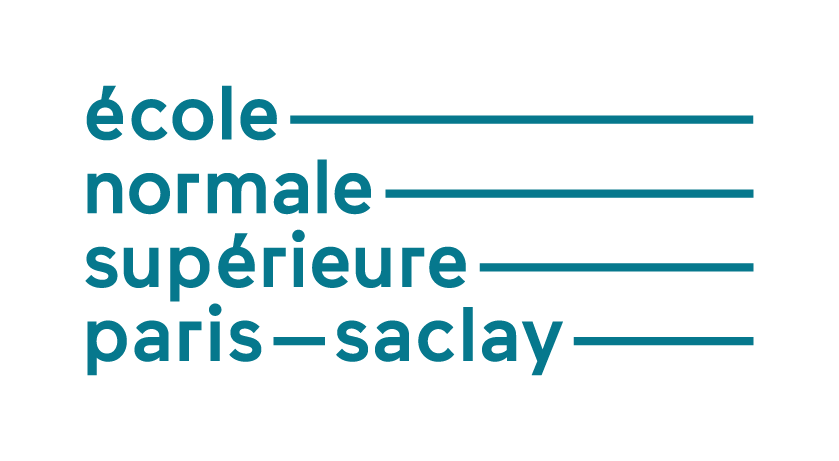

<!-- En-tête : photo et liens à gauche, présentation à droite (une seule colonne sur mobile). -->
:::: {.hero}

::: {.hero-id}
{.hero-photo fig-alt="Portrait of Gregory Faraut"}

[Gregory Faraut]{.hero-name}

[Professor · ENS Paris-Saclay · Université Paris-Saclay]{.hero-role}

[<i class="bi bi-envelope"></i> Email](mailto:gregory.faraut+pages@ens-paris-saclay.fr){.hero-link}
[<i class="bi bi-journal-text"></i> HAL](https://cv.hal.science/gfaraut){.hero-link}
[<i class="bi bi-person-badge"></i> ORCID](https://orcid.org/0000-0003-0388-932X){.hero-link}
[<i class="bi bi-building"></i> LURPA](https://lurpa.ens-paris-saclay.fr){.hero-link}

<!-- Logos officiels des institutions (fichiers dans assets/, à ne pas retoucher). -->
::: {.hero-logos}
[{.logo-ups}](https://www.universite-paris-saclay.fr/)
[{.logo-ens}](https://ens-paris-saclay.fr)
[{.logo-lurpa}](https://lurpa.ens-paris-saclay.fr)
:::
:::

::: {.hero-text}
Full professor at [ENS Paris-Saclay](https://www.ens-paris-saclay.fr) ([Université Paris-Saclay](https://www.universite-paris-saclay.fr/)),
member of the [LURPA](https://lurpa.ens-paris-saclay.fr) laboratory and teacher in the
[Mechanical Engineering Department](https://ens-paris-saclay.fr/en/education/departements/mechanical-engineering-department).

<!-- Mots-clés : un par ligne ; garder la même liste que sur ORCID et HAL. -->
::: {.keywords}
- Discrete Event Systems
- Behavior identification
- Human-Cyber-Physical Systems
- Cybersecurity
- Resilient control
- Digital twins
- Hybrid automata
- Petri nets
:::

## Biosketch

<!-- Biographie à la 3e personne, pour que d'autres puissent la reprendre telle quelle
     (programme de conférence, jury, présentation d'un exposé) : le bouton la copie. -->
::: {#biosketch-text}
Gregory Faraut is a Full Professor at ENS Paris-Saclay (Université Paris-Saclay). At the
LURPA laboratory, he headed the research theme on the dependability and performance of
cyber-physical systems from 2022 to 2025, and remains in charge of research on the
dependability of production systems, especially through **Discrete Event Systems**. He builds
faithful, up-to-date **digital twins** of complex systems from their observed behavior, and
uses them to detect, explain and respond to deviations: faults, cyber-attacks or changes in
human behavior. His work combines formal models — automata, Petri nets, hybrid automata — with
machine learning. Its applications range from manufacturing systems and the reverse
engineering of legacy PLC-based control systems to the home monitoring of frail people and
hospital clinical pathways.

He received his PhD from INSA Lyon in 2010, after a stay as a research scholar at the
University of Michigan, and his habilitation (HDR) from Université Paris-Saclay in 2022. He
was an Associate Professor at ENS Cachan, then ENS Paris-Saclay, from 2011 to 2022. He works
with universities in Spain, Italy, Japan and China, and with industry, from EDF R&D to
start-ups. He was Associate Editor of the IEEE Transactions on Automation Science and
Engineering (2022–2025) and founding co-chair of the IEEE RAS Technical Committee on
Automation in Health Care Management (2013–2025), and heads the Master's programme in Complex
Systems Engineering of Université Paris-Saclay.
:::

```{=html}
<!-- data-nosnippet : Google ne reprend pas le libellé du bouton dans ses extraits. -->
<div data-nosnippet><button type="button" class="copy-bio" data-target="biosketch-text"><i class="bi bi-clipboard"></i> Copy the biosketch</button></div>
<script>
document.querySelectorAll('.copy-bio').forEach(function (b) {
  var label = b.innerHTML;
  b.addEventListener('click', function () {
    var text = document.getElementById(b.dataset.target).innerText.trim();
    navigator.clipboard.writeText(text).then(function () {
      b.innerHTML = '<i class="bi bi-check2"></i> Copied';
      setTimeout(function () { b.innerHTML = label; }, 2000);
    });
  });
});
</script>
```
:::

::::

## Research themes

<!-- La figure (assets/img/research-loop.svg) en pleine largeur, puis une carte par thème,
     côte à côte ; chaque carte mène à la page du thème (research/…), la vue d'ensemble est sur
     research.qmd. Garder chaque carte courte (une phrase d'une vingtaine de mots) pour que
     les trois restent de hauteur voisine. -->
:::: {.research-overview}

```{=html}
<div class="research-loop">

</div>
```

::: {.research-overview-cards}

::: {.theme-card .t-identification}
### [[1]{.theme-num} Dynamic identification](research/identification.qmd)

Building a faithful digital twin of a system from its observed behavior, kept up to date over
time — also for reverse engineering.
:::

::: {.theme-card .t-detection}
### [[2]{.theme-num} Deviation detection & characterization](research/detection.qmd)

Detecting and explaining faults, cyber-attacks and changes in human behavior, up to
predictive maintenance.
:::

::: {.theme-card .t-control}
### [[3]{.theme-num} Resilient control](research/control.qmd)

Controlling complex systems with performance and frugality, planning multi-robot paths, and
staying operational under faults and cyber-attacks.
:::

[Overview of my research →](research.qmd){.more-link}
:::

::::

## Recent publications

::: {#recent-publications}
:::

[All publications →](publications.qmd){.more-link}

## Past positions

- **2011–2022** — Associate Professor at LURPA (ISA team), ENS Cachan / ENS Paris-Saclay
- **2009–2011** — ATER (Assistant Professor), [Ampère Lab](http://www.ampere-lab.fr/), Discrete Event Systems team, INSA Lyon
- **PhD** — Safe mode switching for discrete-event systems, Ampère Lab, supervised by Eric Niel and Laurent Piétrac
