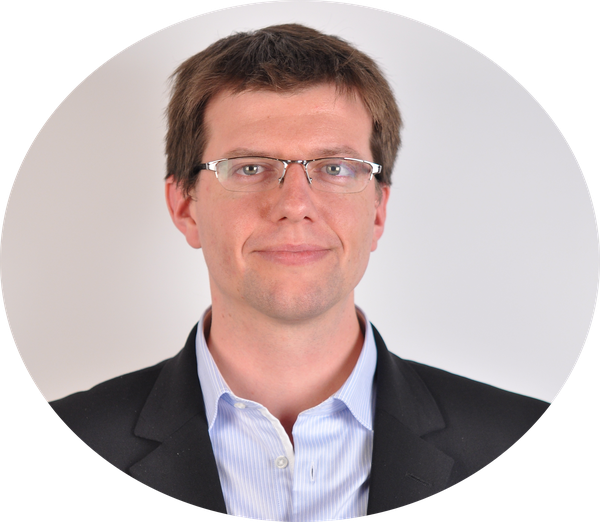
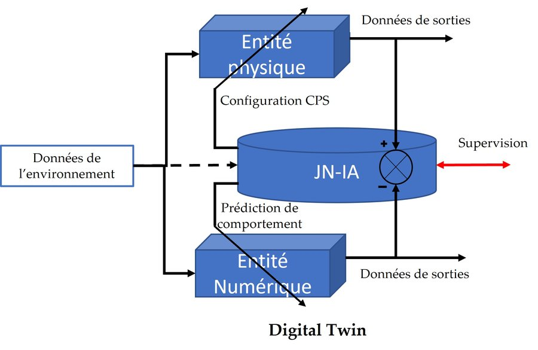

<!-- En-tête : photo et liens à gauche, présentation à droite (une seule colonne sur mobile). -->
:::: {.hero}

::: {.hero-id}
{.hero-photo fig-alt="Portrait of Gregory Faraut"}

[Gregory Faraut]{.hero-name}

[Professor · ENS Paris-Saclay · Université Paris-Saclay]{.hero-role}

[<i class="bi bi-envelope"></i> Email](mailto:gregory.faraut+pages@ens-paris-saclay.fr){.hero-link}
[<i class="bi bi-journal-text"></i> HAL](https://cv.hal.science/gfaraut){.hero-link}
[<i class="bi bi-person-badge"></i> ORCID](https://orcid.org/0000-0003-0388-932X){.hero-link}
[<i class="bi bi-building"></i> LURPA](https://lurpa.ens-paris-saclay.fr){.hero-link}
:::

::: {.hero-text}
Full professor at [ENS Paris-Saclay](https://www.ens-paris-saclay.fr) ([Université Paris-Saclay](https://www.universite-paris-saclay.fr/)),
member of the [LURPA](https://lurpa.ens-paris-saclay.fr) laboratory and teacher in the
[Mechanical Engineering Department](https://ens-paris-saclay.fr/en/education/departements/mechanical-engineering-department).

## Biosketch

Since 2022, I am full professor at LURPA and head of the research theme **Industry 5.0**, which
focuses on the safety and performance of **Human-Cyber-Physical Systems (H-CPS)**. I am
specialized in Control Theory and Behavior Identification. With a strong foundation in Computer
Science and Electrical Engineering, I hold a PhD from INSA Lyon and an HDR from Université
Paris-Saclay.

My research focuses on **Discrete Event Systems**, **Digital Twins** and **behavior
identification of complex systems**, with applications to intelligent manufacturing,
healthcare and Ambient Assisted Living (AAL). I am actively involved in professional
activities, including editorial roles and technical committees within the IEEE Robotics and
Automation Society.
:::

::::

## Research themes

<!-- Une carte par thème ; le lien mène à la section correspondante de research.qmd. -->
:::: {.theme-cards}

::: {.theme-card}
[{fig-alt="Identification of a cyber-physical system from observed data"}](research.qmd#identification)

### [Behavior identification](research.qmd#identification)

Building discrete-event and hybrid models of a system from its observed behavior.
:::

::: {.theme-card}
[{fig-alt="Digital twin architecture"}](research.qmd#digital-twins)

### [Digital twins & H-CPS](research.qmd#digital-twins)

Adaptive digital twins, diagnosis and resilience of Human-Cyber-Physical Systems.
:::

::: {.theme-card}
[{fig-alt="Probabilistic automaton of daily-life activities"}](research.qmd#healthcare)

### [Healthcare & AAL](research.qmd#healthcare)

Modeling daily-life habits in smart homes to recognize activities and detect deviations.
:::

::::

## Past positions

- **2011–2022** — Associate Professor at LURPA (ISA team), ENS Cachan / ENS Paris-Saclay
- **2009–2011** — ATER (Assistant Professor), [Ampère Lab](http://www.ampere-lab.fr/), Discrete Event Systems team, INSA Lyon
- **PhD** — Safe mode switching for discrete-event systems, Ampère Lab, supervised by Eric Niel and Laurent Piétrac
