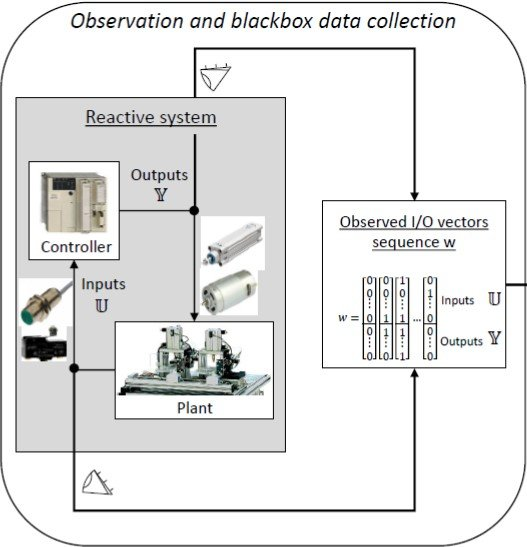
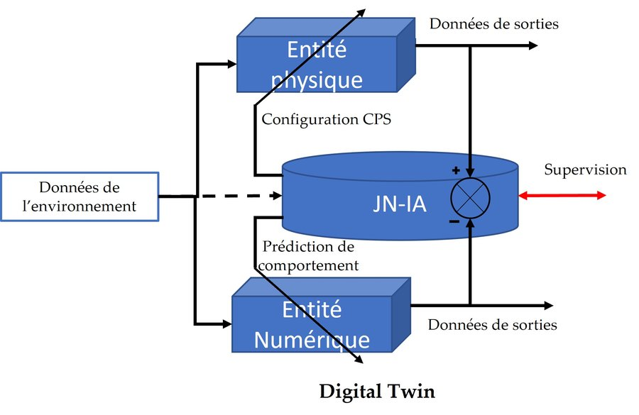
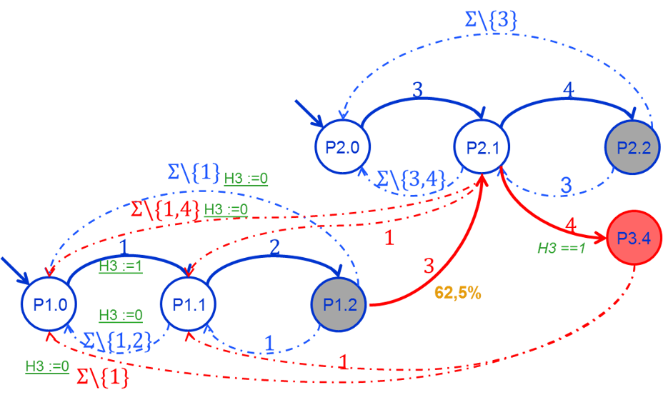

<!--
  MODE D'EMPLOI
  Chaque thème suit le même plan : figure, texte de présentation, thèses liées,
  publications choisies. Pour chaque publication choisie, une phrase dit ce qu'elle
  apporte (esprit DORA : juger un travail sur son contenu, pas sur la revue).
  Ces phrases sont un premier jet tiré des résumés HAL et OpenAlex : à réécrire librement.

  Ajouter une publication choisie (2 lignes, la 1re finit par une barre oblique inverse) :
  - [Titre](https://lien-HAL-ou-DOI) — *Revue ou conférence*, année.\
    [Ce que l'article apporte, en une phrase.]{.contribution}

  L'identifiant entre accolades ({#identification}…) est la cible des cartes de
  l'accueil : le garder si l'on renomme un titre.
-->

My research interests focus on the **behavioral identification** of **complex systems**,
using formal models of Discrete Event Systems and Machine Learning techniques.

## Behavior identification of complex systems {#identification}

::: {.grid}
::: {.g-col-12 .g-col-md-4 .axis-figure}
{fig-alt="Identification of a cyber-physical system from observed data"}
:::
::: {.g-col-12 .g-col-md-8}
Building models of a system — automata, interpreted Petri nets, hybrid automata — from the
observation of its inputs and outputs, including the part of its behavior that cannot be
observed directly.

**Related PhD theses** — Jérémie Saives (2013–2016), Yan Monier (2021–2024),
Guillaume Brieussel (2026–2029).

**Selected publications**

- [An Optimization-Based Approach to Discover the Unobservable Behavior of a Discrete-Event System Through Interpreted Petri Nets](https://hal.science/hal-02369807) — *IEEE T-ASE*, 2019.\
  [Discovers the unobservable part of a system's behavior from long event sequences, by adding places to an interpreted Petri net through optimization-based net synthesis.]{.contribution}
- [Automated Partitioning of Concurrent Discrete-Event Systems for Distributed Behavioral Identification](https://hal.science/hal-01564213) — *IEEE T-ASE*, 2017.\
  [Splits a concurrent system into subsystems so that the distributed models identified from its input/output events are as readable as possible, for reverse engineering.]{.contribution}
- [A new global optimization for hybrid automaton identification](https://hal.science/hal-04804902) — *WODES*, 2024.\
  [Adds a global optimization step to hybrid automaton identification, balancing model distance, sequential fidelity and automaton structure instead of solving local problems one after another.]{.contribution}
:::
:::

## Digital twins & Human-Cyber-Physical Systems {#digital-twins}

::: {.grid}
::: {.g-col-12 .g-col-md-4 .axis-figure}
{fig-alt="Digital twin architecture"}
:::
::: {.g-col-12 .g-col-md-8}
Within the **Industry 5.0** research theme of LURPA: adaptive digital twins of
cyber-physical systems, model-based diagnosis of cyber-attacks and resilient control.

**Related PhD theses** — Yan Monier (2021–2024), Romain Thibert (2022–2026).

**Selected publications**

- [Inferring Moore Machine for Adaptive Online Hybrid Automaton Identification](https://hal.science/hal-04238162) — *IFAC World Congress*, 2023.\
  [Identifies hybrid systems online and adaptively, through a mapping between hybrid automata and discrete-event Moore machines, so that the model can follow the system as it evolves.]{.contribution}
- [Construction of Model-based Diagnosis of Cyber-Attack in Cyber-Physical Systems Using Labeled Petri Nets](https://hal.science/hal-04213244) — *IEEE ETFA*, 2023.\
  [Builds a diagnosis model from labeled Petri nets to detect attacks between a process and its controller before they destabilize the system.]{.contribution}
- [Supervisory Control Under Indefinite Actuator and Sensor Attacks: Prescribed Resilience](https://doi.org/10.1109/tac.2026.3665131) — *IEEE Transactions on Automatic Control*, 2026.\
  [Designs supervisors with a prescribed resilience: each unsafe state is protected against a given number of attacks on actuators and on sensors.]{.contribution}
:::
:::

## Healthcare & Ambient Assisted Living {#healthcare}

::: {.grid}
::: {.g-col-12 .g-col-md-4 .axis-figure}
{fig-alt="Probabilistic automaton of daily-life activities"}
:::
::: {.g-col-12 .g-col-md-8}
Modeling the daily-life habits of frail people living in a smart home, from binary sensors,
to locate the inhabitant, recognize activities and detect behavioral deviations over time;
more recently, modeling clinical pathways in hospitals.

**Related PhD theses** — Jérémie Saives (2013–2016), Kevin Viard (2015–2018),
Kevin Fouquet (2018–2021).

**Selected publications**

- [Activity Discovery and Detection of Behavioral Deviations of an Inhabitant From Binary Sensors](https://hal.science/hal-01253810) — *IEEE T-ASE*, 2015.\
  [Discovers the activities of a smart-home inhabitant by sequence mining on binary sensor events, models them as automata, and detects deviations from the requirements set by medical staff.]{.contribution}
- [Human Activity Discovery and Recognition Using Probabilistic Finite-State Automata](https://hal.science/hal-02557589) — *IEEE T-ASE*, 2020.\
  [Discovers and recognizes activities of daily living with probabilistic finite-state automata, using a normalized likelihood and perplexity whose computation is simplified.]{.contribution}
- [Model-Based Approach for Anomaly Detection in Smart Home Inhabitant Daily Life](https://hal.science/hal-04160196) — *ACC*, 2021.\
  [Models life habits — activity durations and ordering — with stochastic timed automata, to detect behavioral changes that may be symptoms of health problems.]{.contribution}
- [Probabilistic timed Petri nets for clinical pathway design and analysis: a case study](https://doi.org/10.1007/s10626-025-00419-4) — *Discrete Event Dynamic Systems*, 2025.\
  [Combines pattern mining and probabilistic timed Petri nets to design and evaluate clinical pathways, applied with medical professionals to anterior cruciate ligament ruptures from real data.]{.contribution}
:::
:::

## Supervisory control & controller synthesis {#control}

Synthesis of discrete controllers for Discrete Event Systems, from my PhD work on safe mode
switching to temporal-logic planning for multi-robot systems and controller generation from
interpreted Petri nets.

**Related PhD work** — Peng Lv (visiting PhD student, 2025).

**Selected publications**

- [Formal Approach to Multimodal Control Design: Application to Mode Switching](https://hal.science/hal-00471885) — *IEEE Transactions on Industrial Informatics*, 2009.\
  [A supervisory-control framework to design each operating mode separately, then resolve the conflicts between modes to obtain ready-to-use control laws.]{.contribution}
- [Equivalence of behaviors between centralized and multi-model approaches](https://hal.science/hal-00759500) — *IEEE CASE*, 2011.\
  [Gives the conditions under which the multi-model approach, with smaller models, yields the same controlled behavior as the centralized one.]{.contribution}
- [Counting Time Temporal Logic for Multi-Robot Path Planning in Finite Horizons](https://doi.org/10.1109/tase.2025.3636053) — *IEEE T-ASE*, 2025.\
  [Extends linear temporal logic to count how many times a sub-task is satisfied, and solves the resulting multi-robot path planning problem by integer linear programming.]{.contribution}
- [Interpreted Higher-Dimensional Automata for Concurrent Discrete-Event Control](https://doi.org/10.1109/wodes69290.2026.11598183) — *WODES*, 2026.\
  [Uses higher-dimensional automata to turn controllers given as interpreted Petri nets into closed-loop controllers, revealing ambiguous or contradictory specifications.]{.contribution}
