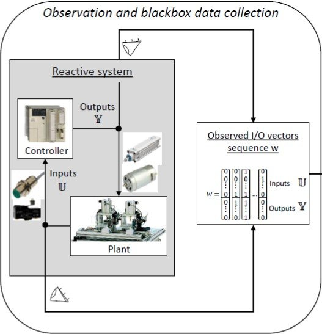
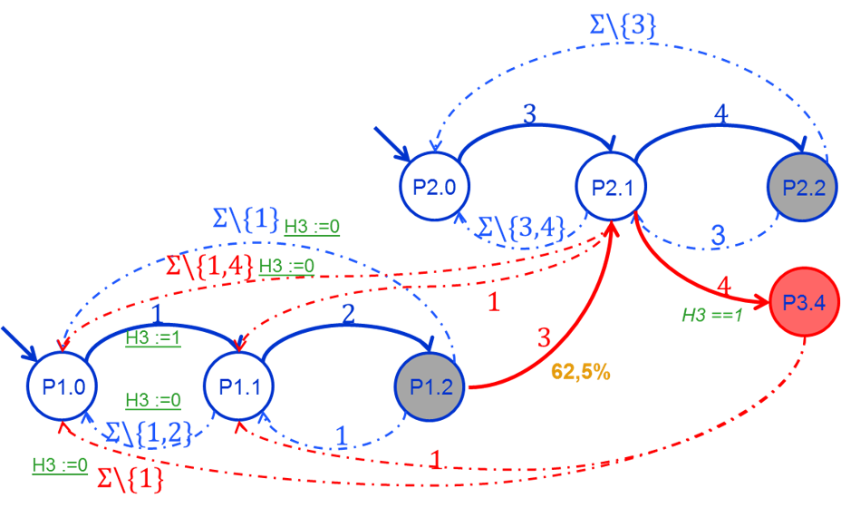

<!--
  MODE D'EMPLOI (même plan pour les trois pages de thème)
  Figure (commune aux trois pages, thème courant mis en avant) : assets/img/research-loop.svg
  Plan : The problem · Contributions · Related PhD theses and projects · Selected publications.
  Les noms des doctorants et des projets renvoient aux pages Supervision et Projects :
  les y tenir à jour d'abord.

  Publication choisie (2 lignes, la 1re finit par une barre oblique inverse \) :
  - [Titre](https://lien-HAL-ou-DOI) — *Revue ou conférence*, année. [Industrial & critical systems]{.domain-tag .domain-industry}\
    [Ce que l'article apporte, en une phrase.]{.contribution}
  Domaine : [Industrial & critical systems]{.domain-tag .domain-industry}
         ou [Human & health]{.domain-tag .domain-human} (facultatif pour un travail méthodologique).
  Ordre : du plus récent au plus ancien. Esprit DORA : on dit ce que l'article apporte,
  pas où il est paru. Les phrases sont un premier jet tiré des résumés : à réécrire librement.
-->

```{=html}
<div class="research-loop research-loop-wide">

</div>
```

## The problem

Model-based methods — fault diagnosis, safety analysis, model checking, simulation, reverse
engineering — all need a model of the system. For many real systems, experts cannot write it:
legacy systems without documentation, state-space explosion, complex systems, human behavior.
Identification builds it from data: given a class of models, a criterion and measurements of
the input and output signals, find the model that best fits the observations (Åström, 1971).

For discrete event systems, no predetermined model structure exists, combinatorics explode,
and part of the behavior cannot be observed. Above all, the goal is not a model built once but
a digital twin: a virtual model that mimics the behavior of its physical system and is updated
with its data throughout its life cycle (AIAA, 2020). It must therefore be faithful to the
observed behavior, readable — for reverse engineering, certification or medical staff — and
follow the system as it ages or is reconfigured. This twin is the core of the other themes:
deviation detection and explainability, behavior equivalence, verification, resilient control.

## Contributions

- **Reverse engineering of PLC-based systems.** Recovering an understandable model of legacy
  control systems whose documentation is missing or outdated: a formal approach for timed
  logic systems based on programmable logic controllers, with EDF R&D (CIFRE PhD started in
  2026).
- **Black-box identification of reactive systems by interpreted Petri nets.** Models readable
  by engineers, built from the input/output events of a controlled system for reverse
  engineering, including the part of its behavior that cannot be observed, and distributed
  into subsystems for large concurrent systems.
- **Hybrid automaton identification for the digital twins of cyber-physical systems.** Models
  that combine discrete and continuous dynamics, identified online and adaptively so that they
  follow the system as it evolves, and optimized globally for fidelity and readability.
- **Identification of human behavior.** Models of the activities of daily living of a
  smart-home inhabitant, discovered from binary sensor events with automata, hidden Markov
  models and probabilistic finite-state automata, to recognize the activity in progress;
  criteria to estimate *a priori* whether a set of sensors allows this recognition; placement
  of motion sensors to locate the inhabitants.
- **Clinical pathways.** Probabilistic timed Petri nets built from hospital data with pattern
  mining, to design and evaluate clinical pathways with the physicians of the Clinical
  Hospital of Zaragoza.

::: {.grid}
::: {.g-col-12 .g-col-md-6 .axis-figure}
{fig-alt="Identification of a reactive system from its observed input and output vectors"}
:::
::: {.g-col-12 .g-col-md-6 .axis-figure}
{fig-alt="Probabilistic automaton of daily-life activities"}
:::
:::

## Related PhD theses and projects

**PhD theses** — Jérémie Saives (2013–2016), Kevin Viard (2015–2018), Yan Monier (2021–2024),
Guillaume Brieussel (2026–2029, CIFRE with EDF R&D); see [Supervision](../team.qmd).

**Projects** — OPTIMA-DTMS, reverse engineering of PLC-based systems (EDF R&D), VALIDATOR,
ProMAut, ITSCABA; see [Projects](../projects.qmd).

## Selected publications

- [Probabilistic timed Petri nets for clinical pathway design and analysis: a case study](https://doi.org/10.1007/s10626-025-00419-4) — *Discrete Event Dynamic Systems*, 2025. [Human & health]{.domain-tag .domain-human}\
  [Combines pattern mining and probabilistic timed Petri nets to design and evaluate clinical pathways, applied with medical professionals to anterior cruciate ligament ruptures from real data.]{.contribution}
- [A new global optimization for hybrid automaton identification](https://hal.science/hal-04804902) — *WODES*, 2024. [Industrial & critical systems]{.domain-tag .domain-industry}\
  [Adds a global optimization step to hybrid automaton identification, balancing model distance, sequential fidelity and automaton structure instead of solving local problems one after another.]{.contribution}
- [Inferring Moore Machine for Adaptive Online Hybrid Automaton Identification](https://hal.science/hal-04238162) — *IFAC World Congress*, 2023. [Industrial & critical systems]{.domain-tag .domain-industry}\
  [Identifies hybrid systems online and adaptively, through a mapping between hybrid automata and discrete-event Moore machines, so that the model can follow the system as it evolves.]{.contribution}
- [Human Activity Discovery and Recognition Using Probabilistic Finite-State Automata](https://hal.science/hal-02557589) — *IEEE T-ASE*, 2020. [Human & health]{.domain-tag .domain-human}\
  [Discovers and recognizes activities of daily living with probabilistic finite-state automata, using a normalized likelihood and perplexity whose computation is simplified.]{.contribution}
- [An Optimization-Based Approach to Discover the Unobservable Behavior of a Discrete-Event System Through Interpreted Petri Nets](https://hal.science/hal-02369807) — *IEEE T-ASE*, 2019. [Industrial & critical systems]{.domain-tag .domain-industry}\
  [Discovers the unobservable part of a system's behavior from long event sequences, by adding places to an interpreted Petri net through optimization-based net synthesis.]{.contribution}
- [Automated Partitioning of Concurrent Discrete-Event Systems for Distributed Behavioral Identification](https://hal.science/hal-01564213) — *IEEE T-ASE*, 2017. [Industrial & critical systems]{.domain-tag .domain-industry}\
  [Splits a concurrent system into subsystems so that the distributed models identified from its input/output events are as readable as possible, for reverse engineering.]{.contribution}

::: {.theme-nav}
[← Research overview](../research.qmd)
[Next theme: Deviation detection & characterization →](detection.qmd)
:::
